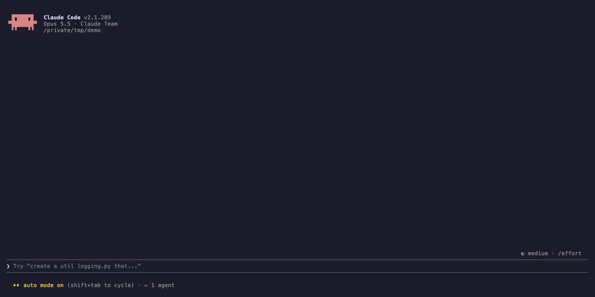

# side-pane

A [Claude Code](https://code.claude.com) plugin that keeps the options and open
questions Claude asks you about in a pane beside the conversation. In a long chat you no
longer scroll back to remember what "option 2" was.



Claude fills the pane itself: the plugin gives it a tool and a short instruction to call
it whenever it lists options or asks you something. Each session has its own pane, so
parallel sessions never overwrite each other, and the last pane of a directory comes
back when you start a new session there.

## Requirements

Claude Code 2.1.289 or newer. The pane is built on Claude Code mods (plugins of function
hooks), which are in early access.

## Install

```
/plugin marketplace add xixiaofinland/side-pane
/plugin install side-pane@side-pane
```

## Use

- The pane opens the first time Claude fills it.
- `/side-pane` shows or hides it; `/side-pane clear` empties it. Once you hide the pane
  (`/side-pane`, its close mark or ctrl+x x), Claude keeps it current but no longer
  reopens it in that session; `/side-pane` shows it again.
- Claude Code places a pane it was not asked for only in a terminal at least 144 columns
  wide (110 once you have opened it yourself). In a narrower terminal you get a toast;
  run `/side-pane` and it opens at any width.

## Settings

Change them in `/config`:

| Setting    | Default | What it does                                    |
| ---------- | ------- | ----------------------------------------------- |
| `autoOpen` | `true`  | Open the pane when Claude first fills it        |
| `maxChars` | `3000`  | Longest pane content in characters; more is cut |

## How it works

- Tools `mcp__side-pane__update` (`{ markdown }`, replaces the pane) and
  `mcp__side-pane__clear`.
- The rules for when to call it ship in the tool's own description, which the plugin keeps
  in the prompt rather than behind ToolSearch, plus a one-line nudge in the first
  message's context. No `CLAUDE.md` rule or memory note is needed.
- The content lives in the session's plugin state; the last pane per working directory
  is also kept in the plugin's store.

## Develop

```
claude plugin validate plugins/side-pane
claude plugin test plugins/side-pane
claude --plugin-dir plugins/side-pane
```

Bump `version` in `plugins/side-pane/.claude-plugin/plugin.json` for every release:
installed copies are cached by version.

## License

MIT
